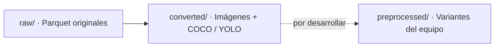

# Datos

Tres carpetas, tres fases:



| Carpeta | Qué guardamos |
|---|---|
| [`raw/`](raw/README.md) | La descarga original, sin tocar |
| [`converted/`](converted/README.md) | Las mismas imágenes y objetos en los formatos de los modelos |
| [`preprocessed/`](preprocessed/README.md) | Los preprocesamientos que probemos más adelante |

Ahora trabajamos con `raw → converted`. Ambos modelos pueden usar las imágenes de `converted/`.

## Particiones

Fuente: [Francesco/parasites-1s07h](https://huggingface.co/datasets/Francesco/parasites-1s07h), de Roboflow-100. Revisión y checksums en [`configs/dataset.json`](../configs/dataset.json).

| Hugging Face | Nombre local | Imágenes |
|---|---|---:|
| `train` | `train` | 1484 |
| `validation` | `val` | 215 |
| `test` | `test` | 411 |

Conservamos estas particiones al convertir los datos.

> [!WARNING]
> **El tar y los Parquet de Hugging Face intercambian los nombres de validación y test.** Comparando los hashes de las imágenes, `test` del tar coincide con `validation` del Parquet (215 imágenes), y `valid` del tar con `test` del Parquet (411). Aquí seguimos los Parquet, como los metadatos `dataset_info.json` de Hugging Face. Evita mezclar las particiones por el nombre de sus carpetas.

## Generar los datos locales

Desde la raíz del repo, con el entorno instalado:

```bash
python3 scripts/download_dataset.py
.venv/bin/python scripts/prepare_dataset.py
```

Los archivos de datos están ignorados por Git. Los README de cada fase sí se comparten.
